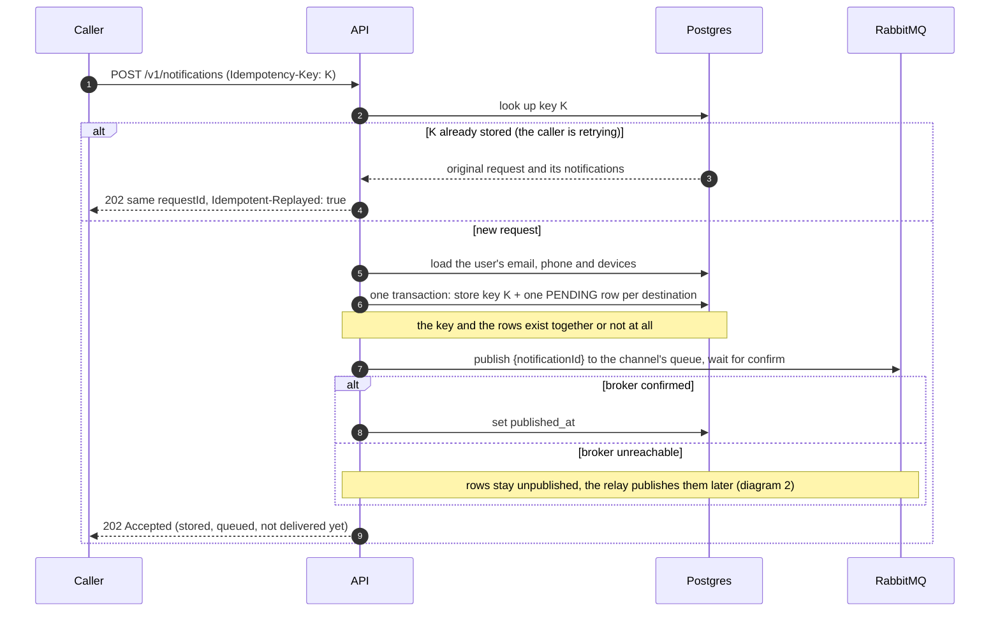
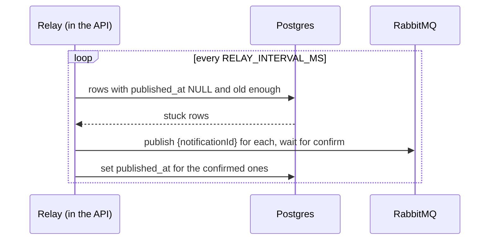
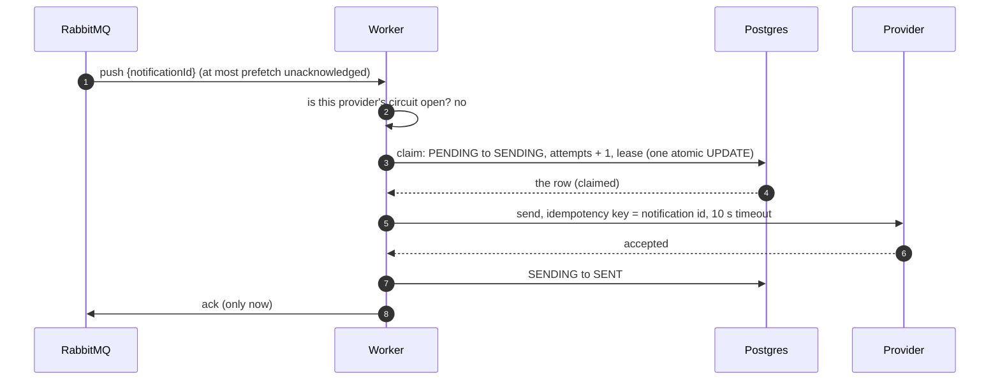
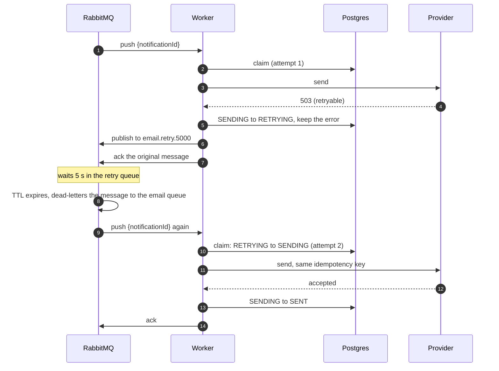
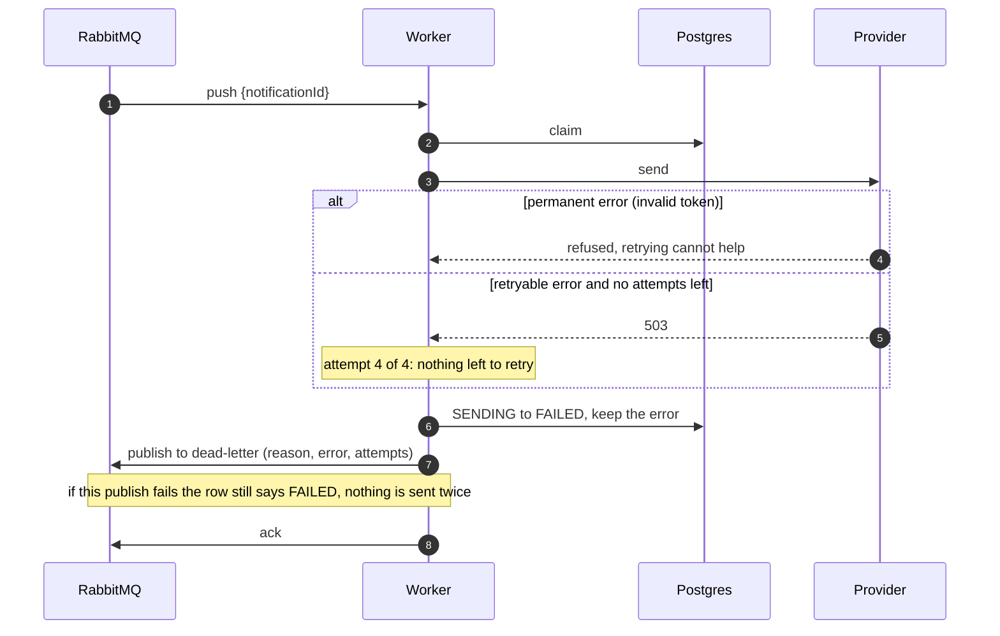
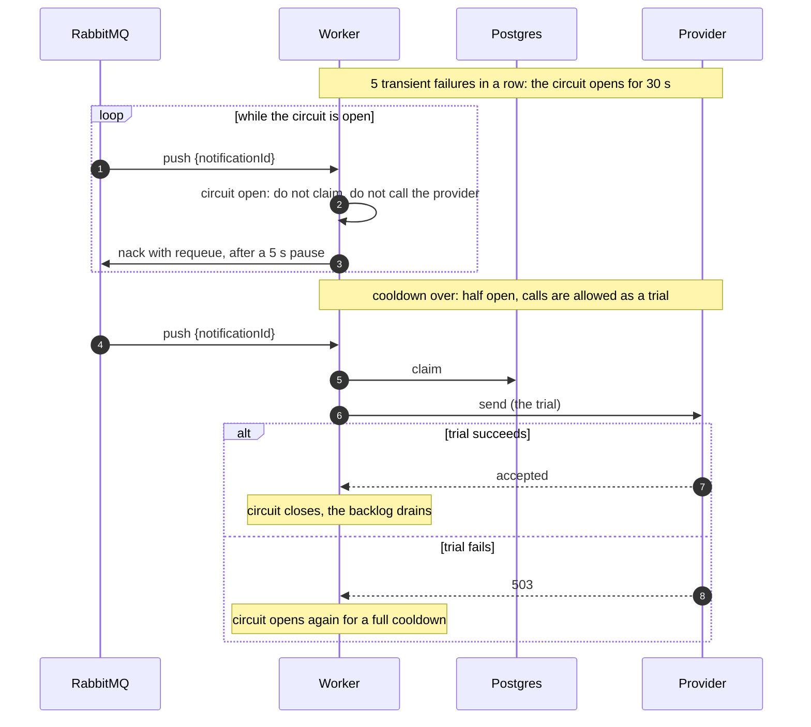
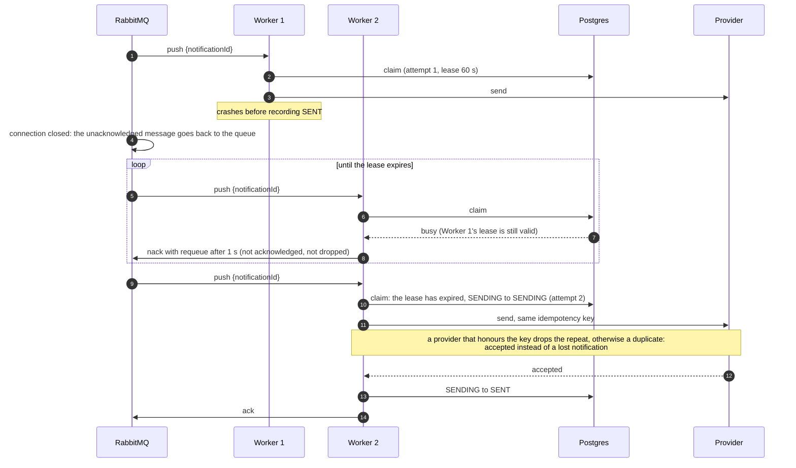
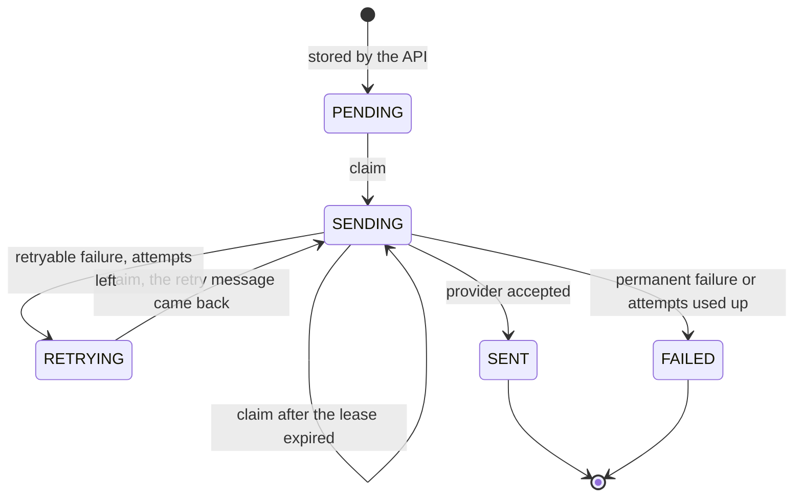

# Flows

Sequence diagrams of how a notification moves through the system, written in Mermaid (GitHub
renders them on this page). Participants: **Caller** (another service), **API**, **DB**
(Postgres), **MQ** (RabbitMQ), **Worker**, **Provider** (APNS, FCM, SMS or email service; mocks
in this project).

## 1. Accepting a request (API)

The API only accepts and queues. Nothing is delivered here. Idempotency layer 1: the
`Idempotency-Key` makes a retried request safe.

## 2. The relay: nothing stored is left unqueued

Runs every few seconds inside the API. Covers a crash between the database write and the publish,
and a broker outage. It may publish a message twice; that is safe because workers are idempotent.

## 3. Delivering a notification (happy path)

Idempotency layer 2: the claim. Of any number of workers holding a copy of the message, exactly
one wins it.

## 4. A retryable failure, then success

The wait happens inside RabbitMQ: the retry queue has a TTL and hands the message back to the main
queue when it expires. No timer in our code.

The delay depends on the attempt: after attempt 1 the 5 s queue, after attempt 2 the 30 s queue,
after attempt 3 the 2 min queue (`RETRY_DELAYS_MS`). Four attempts at most.

## 5. Giving up: permanent failure or attempts used up

The database row is the truth. The dead-letter queue is a signal for operators, published after
the row is written and best effort.

A message that is not valid JSON, or has no notification id, never reaches the processor: the consumer
publishes it to the dead-letter queue and acknowledges it only after that succeeds.

## 6. A provider is down: the circuit breaker

The breaker is checked **before** the claim, so notifications do not use up attempts against a
provider that is known to be down.

Permanent errors (invalid token) never open the circuit: the provider answered, so it is healthy.

## 7. A worker crashes in the middle of a send

Idempotency layers 2 and 3. A message that finds the notification claimed is **not** acknowledged:
if the worker holding it died, that message is what makes us notice when the lease expires.

If Worker 1 had **not** crashed and was only slow, Worker 2 keeps getting `busy`. Once Worker 1
records `SENT`, the next claim answers `done` and the duplicate message is acknowledged and dropped.

## 8. Status of a notification

